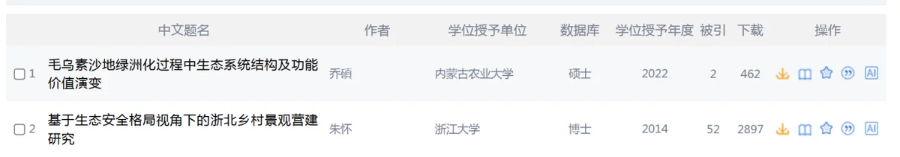
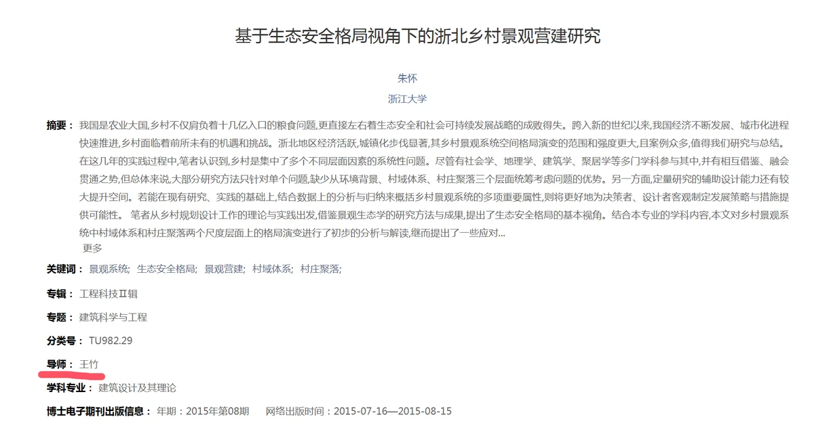
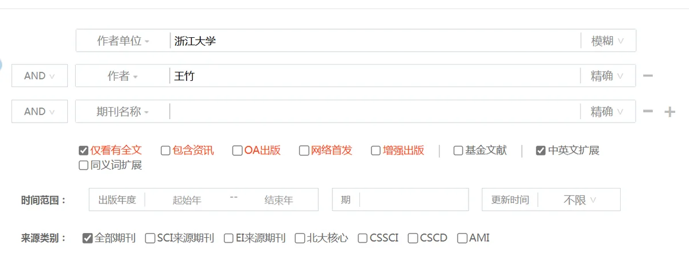
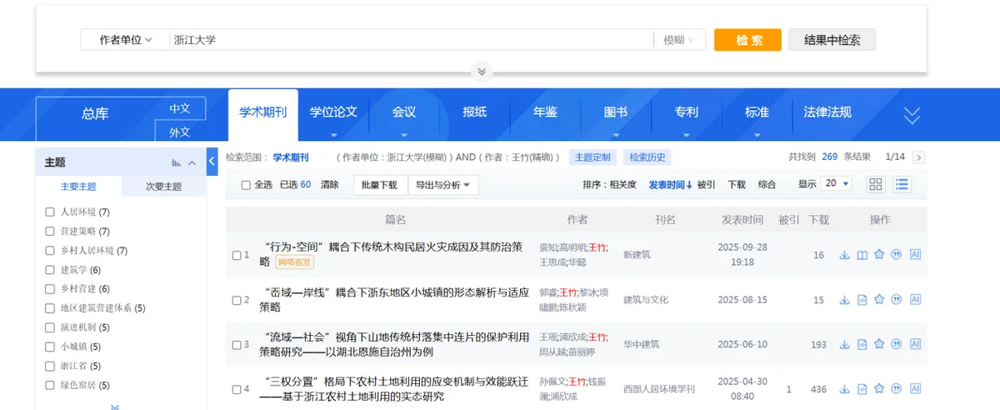
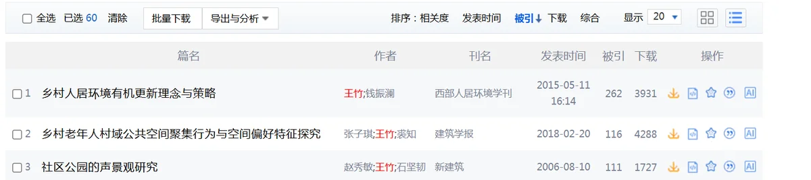

# 真题讲解：一道检索题的完整过程

这是一道 2026 年校赛的题，把「怎么想、怎么查」走一遍比看十条要点管用。

## 题目

> 我校某位教师于 2014 年发表其博士论文，其中两个论文关键词为**景观系统**、**生态安全格局**，请问**以其导师为第一作者引用量最高**的期刊论文是哪篇。

!!! abstract "先圈关键信息"
    时间：**2014 年**　关键词：**景观系统**、**生态安全格局**　要找的人：**导师（第一作者）**　排序依据：**引用量最高**

这道题的难点不在检索，在于它问了两层：先靠关键词找到博士论文 → 再从论文里找到导师是谁 → 再查导师一作的论文。**一次检索查不出来。**

## 第 1 步：选库

题目没有限定用哪个数据库，所以以知网为例。这种不给库的题，用自己最熟的就行。

## 第 2 步：进专业检索

知网首页右侧 → **高级检索** → **专业检索**。

普通检索框填不下这种组合条件，专业检索式才是这题的正确入口。

## 第 3 步：写检索式

```
KY=景观系统 AND KY=生态安全格局
```

`KY` 代表关键词。这句的意思是「关键词为景观系统」**且**「关键词为生态安全格局」。

搜索可得：



## 第 4 步：认年份

题目说的是 **2014 年**发表的博士论文，所以在结果里找 2014 年那篇——是第二篇。



## 第 5 步：从论文里找导师

进入这篇论文的详情页，可以看到它的导师名字：**王竹**。

回到**高级检索**界面。

## 第 6 步：查导师一作的论文

三个检索框里，任意两个框分别选：

- 作者 —— 王竹
- 作者单位 —— 浙江大学



检索可得：



## 第 7 步：按被引排序

知网默认按**发表时间**排序，所以要在排序那一栏点「**被引**」。



## 答案

**《乡村人居---策略》**。

本题完成。

!!! note "关于专业检索式"
    知网的检索式语法在专业检索界面右侧就有说明，常用的就那么几个，不用背。考场现查也行。

---

*整理自《2027 年高职高专信息素养大赛参赛指南（校赛）》，编写时间 2026 年 9 月 25 日。*
